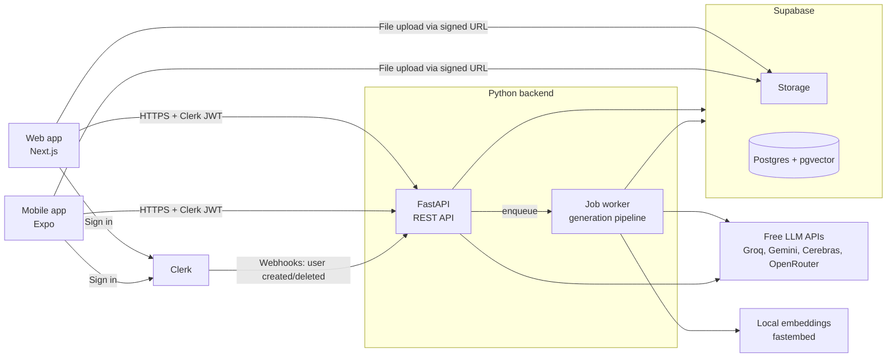

# 01 — Tech Stack

Reviewer Generator: students upload notes or a PDF and get flashcards, quizzes and problem sets, scheduled with spaced repetition.

The stack is a **Python (FastAPI) backend**, a **Next.js web app** and a **React Native (Expo) mobile app**. **Clerk** handles sign-in, and **Supabase** provides Postgres (with pgvector) and file storage. Every AI component runs on **free tiers or local models**.

## 1. Architecture at a glance



- Clients sign in with Clerk and upload files straight to Supabase Storage using a short-lived signed URL from the API.
- Every other action goes through the FastAPI REST API, which verifies the Clerk session token.
- **Clients never talk to the Supabase database.** Only the backend connects to Postgres, directly (see `05-database-schema.md` §1).
- Slow work (extraction, chunking, embeddings, AI generation) runs in a background worker.

## 2. Backend

| Concern | Choice | Notes |
| --- | --- | --- |
| Language | Python 3.12 | |
| Package manager | `uv` | Fast installs and a lockfile |
| Web framework | FastAPI | Async, automatic OpenAPI schema (used to generate the frontend client) |
| Validation | Pydantic v2 | Request/response models and AI output schemas |
| Database access | SQLAlchemy 2 (async) + asyncpg, **direct Postgres connection** through Supabase's connection pooler | Not the Supabase REST API; see `05-database-schema.md` |
| Migrations | Alembic | Includes the pgvector extension, indexes and RLS settings |
| Background jobs | Procrastinate (Postgres-backed queue) | No Redis needed; arq + Redis is an alternative |
| Auth | Clerk session JWT verified with `clerk-backend-api` (or PyJWT against Clerk's JWKS) | Checks signature, expiry, issuer and authorized party (`azp`) |
| Clerk webhooks | `svix` to verify signatures | Syncs `user.created`, `user.updated`, `user.deleted` into `profiles` |
| Storage | Supabase Storage via `supabase-py` (service role, backend only) | Signed upload and download URLs |
| PDF extraction | PyMuPDF (`pymupdf`) | Text and page numbers |
| Tokenizing for chunking | `tiktoken` (approximate counts) | |
| LLM gateway | LiteLLM | One interface for all providers, with fallbacks and retries |
| Structured AI output | Instructor + Pydantic | Validates JSON and retries on invalid output |
| Embeddings | `fastembed` with `BAAI/bge-small-en-v1.5` (384 dimensions) | Runs on CPU in-process; no API or rate limit |
| Math engine | SymPy | Safe parsing and evaluation of problem formulas |
| Units | Pint | Unit conversion and dimension checks for problems |
| Code execution (coding problems) | Judge0 hosted API (free tier) at generation time; `wasmtime` WebAssembly runner as a Python-only fallback; Pyodide in the browser later for student code | Never `exec()` or `subprocess` in the backend |
| Rate limiting (API) | `slowapi` | Per-user limits on AI endpoints |
| Logging | `structlog` (JSON logs) | |
| Error tracking | Sentry (free developer plan) | Optional |
| Testing | pytest, pytest-asyncio, httpx, respx, Hypothesis, Supabase local (Docker) | See `07-backend-test-cases.md` |
| Lint/format | Ruff, mypy | |

## 3. AI providers (all free)

| Role | Primary | Fallbacks | Why |
| --- | --- | --- | --- |
| Bulk generation (flashcards, MCQs, problem templates) | Groq (Llama 3.3 70B) | Cerebras, then Gemini Flash | Fast, supports JSON output, generous daily limit |
| Verification (independent solve of problems) | A different provider from the generator (e.g. Gemini Flash if Groq generated) | OpenRouter free model | Two different models agreeing is a stronger check |
| Interactive (explain my mistake, topic generation) | Groq | Gemini Flash | Lowest latency |
| Embeddings | Local `fastembed` | — | Free, unlimited, deterministic |
| Local development | Ollama (e.g. Llama 3.1 8B or Qwen 2.5 7B) | — | Unlimited prompt testing offline |

Model names and free limits change often. They are set in config (`.env`), not hard-coded. **Privacy note:** Gemini's free tier may use prompts to improve Google's products, so either say so in the privacy notice or keep student content on providers that don't.

## 4. Web frontend

| Concern | Choice |
| --- | --- |
| Framework | Next.js (App Router), TypeScript |
| Styling | Tailwind CSS + shadcn/ui |
| Data fetching | TanStack Query |
| API client | Generated from FastAPI's OpenAPI schema with `openapi-typescript` + `openapi-fetch` |
| Auth | Clerk (`@clerk/nextjs`): prebuilt sign-in/sign-up, middleware to protect routes, `getToken()` for API calls |
| Forms | React Hook Form + zod |
| Math rendering | KaTeX |
| Charts | Recharts |
| Testing | Vitest, React Testing Library, MSW, Playwright, axe-core |

## 5. Mobile frontend

| Concern | Choice |
| --- | --- |
| Framework | React Native with Expo (Expo Router), TypeScript |
| Styling | NativeWind (Tailwind classes) |
| Data fetching | TanStack Query (same hooks as web) |
| Auth | Clerk (`@clerk/clerk-expo`) with SecureStore token cache; Google sign-in via Clerk OAuth |
| File picking | `expo-document-picker` |
| Gestures and animation | `react-native-gesture-handler`, `react-native-reanimated` |
| Notifications | `expo-notifications` (local daily reminder) |
| Math rendering | KaTeX in `react-native-webview` |
| Charts | Victory Native |
| Testing | Jest, React Native Testing Library, MSW, Maestro (end-to-end) |
| Builds | Expo EAS (free tier) |

## 6. Shared code

The repo is a Turborepo monorepo with pnpm workspaces for the TypeScript apps. The Python backend sits beside them.

```
reviewer/
├── apps/
│   ├── web/          # Next.js
│   └── mobile/       # Expo
├── packages/
│   ├── api-client/   # generated types + fetch client + TanStack Query hooks
│   └── ui-tokens/    # colors, spacing, type scale shared by both apps
└── backend/          # FastAPI app, worker, Alembic, tests (uv project)
```

Business rules (SM-2 scheduling, grading, quiz sampling) live **only in the backend**. The clients display results and never compute scores or due dates themselves.

## 7. Data and infrastructure

| Concern | Choice |
| --- | --- |
| Database | Supabase Postgres + pgvector (HNSW index, 384 dimensions); schema in `05-database-schema.md` |
| File storage | Supabase Storage, private `uploads` bucket |
| Auth | Clerk (email + Google); Supabase Auth is not used |
| Web hosting | Vercel (Hobby) |
| Backend hosting | Render, Fly.io or Koyeb free tier; for the MVP the API and worker can run in one process |
| CI | GitHub Actions: lint, type-check, tests, OpenAPI client generation check |

Check current free-tier terms for hosting when deploying. Some free web services sleep when idle, which only delays the first request.

## 8. Environment variables (backend)

```
DATABASE_URL=postgresql+asyncpg://...pooler.supabase.com:5432/postgres   # session pooler for the API
WORKER_DATABASE_URL=                                                     # same, used by the job worker
SUPABASE_URL=
SUPABASE_SERVICE_ROLE_KEY=        # Storage only; never sent to clients
CLERK_SECRET_KEY=
CLERK_JWKS_URL=https://<your-clerk-frontend-api>/.well-known/jwks.json
CLERK_ISSUER=https://<your-clerk-frontend-api>
CLERK_AUTHORIZED_PARTIES=https://your-web-app.vercel.app,http://localhost:3000
CLERK_WEBHOOK_SECRET=
GROQ_API_KEY=
GEMINI_API_KEY=
CEREBRAS_API_KEY=
OPENROUTER_API_KEY=
LLM_BULK_MODELS=groq/llama-3.3-70b-versatile,cerebras/llama-3.3-70b,gemini/gemini-flash-latest
LLM_INTERACTIVE_MODELS=groq/llama-3.3-70b-versatile,gemini/gemini-flash-latest
LLM_VERIFY_MODELS=gemini/gemini-flash-latest,openrouter/<free-model>
EMBEDDING_MODEL=BAAI/bge-small-en-v1.5
CODE_RUNNER=judge0                # judge0 | wasm
JUDGE0_API_URL=
JUDGE0_API_KEY=
MAX_PDF_PAGES=50
MAX_UPLOAD_MB=20
SENTRY_DSN=
```