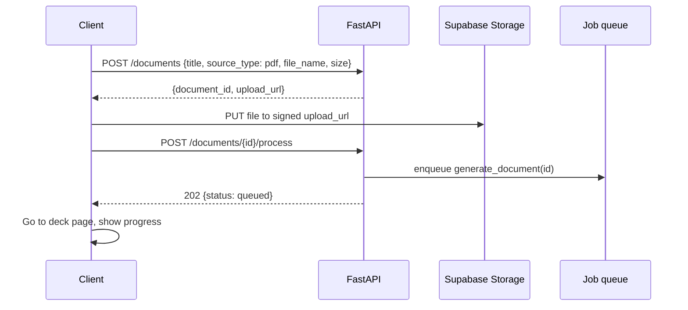
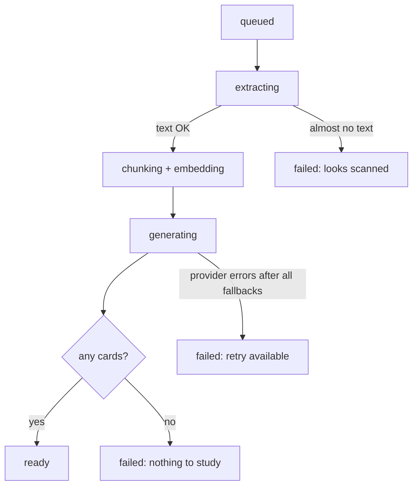
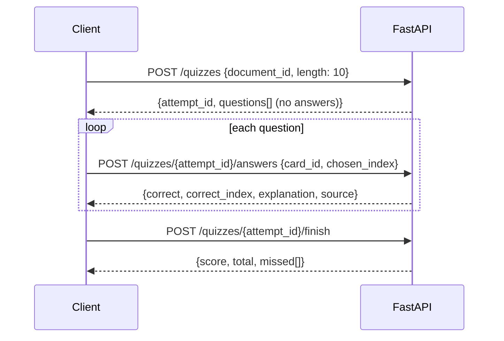
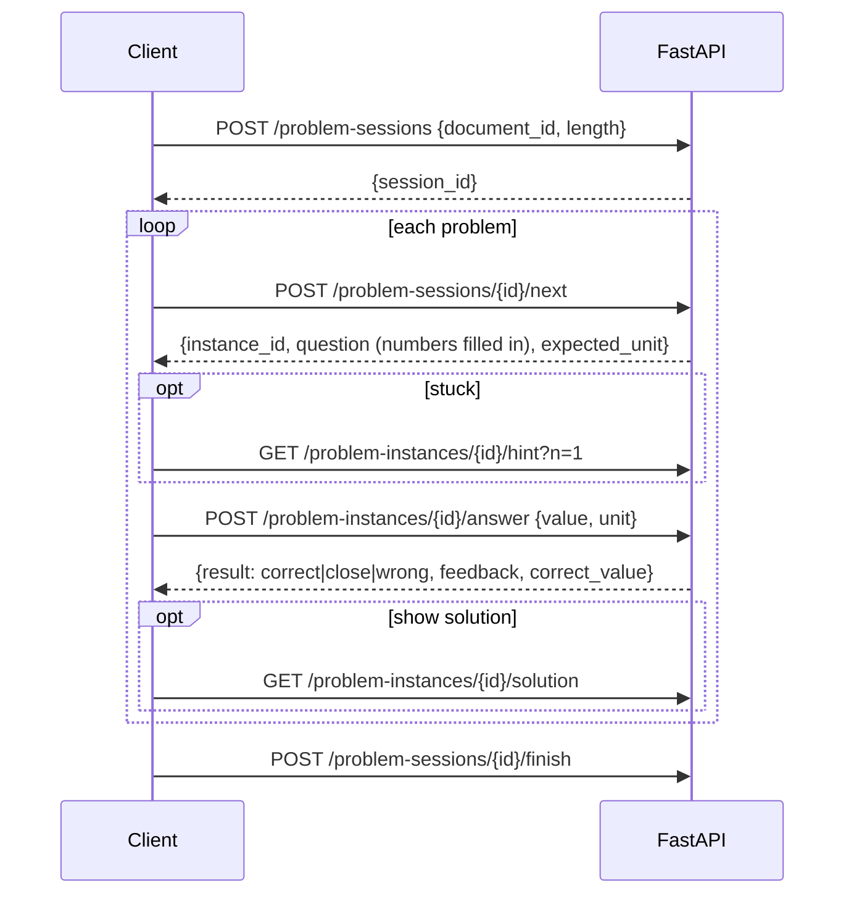

# 02 — User Flows

Eleven flows cover the MVP. Each flow is the same on web and mobile unless a step says otherwise. Each flow lists the API calls it makes (detailed in `03-backend.md`) and its use case ID (detailed in `06-use-cases.md`).

| # | Flow | Use case |
| --- | --- | --- |
| F1 | Sign up and sign in | UC-01 |
| F2 | Upload a PDF | UC-02 |
| F3 | Paste notes | UC-03 |
| F4 | Generation (background) | UC-04 |
| F5 | Flashcard review | UC-05 |
| F6 | Quiz | UC-06 |
| F7 | Explain my mistake | UC-07 |
| F8 | Generate cards on a topic | UC-08 |
| F9 | Problem set practice | UC-09 |
| F10 | Dashboard | UC-10 |
| F11 | Manage cards and decks (flag, edit, delete) | UC-11 |

---

## F1. Sign up and sign in

1. The student opens the app and sees Clerk's sign-in screen: **Continue with Google** or **email** (code or password, depending on your Clerk settings).
2. Clerk creates the account and session. Clerk sends a `user.created` webhook to `POST /webhooks/clerk`, and the backend creates the `profiles` row.
3. On sign-in, the app calls `GET /me` with the Clerk session token. If the webhook hasn't arrived yet, the backend creates the profile then, so the order doesn't matter.
4. A new user lands on an empty dashboard with one call to action: **Upload your notes**.
5. A returning user lands on the dashboard.
6. If the user deletes their account in Clerk, the `user.deleted` webhook removes their profile and all their data (cascade) and their files in Storage.

**Mobile:** Clerk's token cache uses SecureStore. The first launch also asks for permission to send a daily review reminder.

---

## F2. Upload a PDF

1. The student picks a PDF (web: drag and drop or browse; mobile: document picker) and can edit the deck title, which defaults to the file name.
2. The client checks the file type (PDF) and size (≤ 20 MB) before uploading.
3. The client calls `POST /documents`, then uploads the file to the signed URL.
4. The client calls `POST /documents/{id}/process`. The backend checks the file exists and the page count is ≤ 50, then queues the job.
5. The client goes to the deck page, which shows generation progress (F4).

---

## F3. Paste notes

1. The student switches to **Paste notes**, pastes text (minimum 200 characters, maximum 100,000) and enters a title.
2. The client calls `POST /documents/text` with the title and text.
3. The backend saves the document and queues the job. No file upload is needed.
4. The client goes to the deck page (F4).

---

## F4. Generation (background)

1. **extracting:** text is read per page. If the average is under 50 characters per page, the job fails with "This looks like a scanned PDF."
2. **chunking + embedding:** repeated headers and footers are removed, the text is split into chunks, and each chunk is embedded.
3. **generating:** for each chunk, flashcards and MCQs are generated. Quantitative chunks also get problem templates, which go through verification.
4. **ready:** the deck page switches from the progress view to the deck view. A notification is shown if the student is elsewhere in the app.
5. **failed:** the deck page shows the reason and a **Retry** button (`POST /documents/{id}/retry`). Retrying skips chunks that already finished.

The client polls `GET /documents/{id}` every 3 seconds while the status is not `ready` or `failed`. The response includes `progress` (chunks done / total).

---

## F5. Flashcard review

1. The student taps **Start review** on the dashboard (all decks) or **Review N due** on a deck.
2. The client calls `GET /reviews/due` (optionally with `document_id`) and receives the due cards in order.
3. The card shows its front. The student taps or presses Space to flip it.
4. The back shows the answer and a **Source · page N** link that opens the source chunk.
5. The student rates the card **Again / Hard / Good / Easy** (keys 1–4 on web). Each button shows the next interval.
6. The client calls `POST /reviews {card_id, rating}`. The backend updates the SM-2 state and returns the next due date.
7. Cards rated **Again** come back at the end of the same session.
8. When no cards are left, a summary shows cards reviewed and the next due time.

**Mobile:** swipe left for Again and right for Good, as an optional shortcut to the buttons.

---

## F6. Quiz

1. The student taps **Start quiz** and picks a length (5, 10 or 20).
2. The backend samples MCQs, weighted toward questions the student has missed before, and shuffles the options. **Correct answers are never sent before the student answers.**
3. The student picks an option and taps **Check answer**.
4. The client shows correct/incorrect, the correct option, the explanation and the source link. On a wrong answer, **Explain my mistake** is also shown (F7).
5. After the last question, the client calls `/finish` and shows the results: score, comparison with the last attempt, missed questions, and **Review missed as flashcards** (which makes the missed cards due now).

---

## F7. Explain my mistake

1. After a wrong quiz answer or a wrong problem answer, the student taps **Explain my mistake**.
2. The client calls `POST /answers/{answer_id}/explain`.
3. The backend retrieves the most relevant chunks from that document (RAG), adds the card's own source chunk, and asks the LLM for a short explanation that uses only those chunks.
4. The client shows the explanation with page references. The result is cached, so asking again returns the same text.

---

## F8. Generate cards on a topic

1. On the deck page, the student types a topic, e.g. "Krebs cycle", and taps **Generate cards**.
2. The client calls `POST /documents/{id}/generate-topic {topic}`.
3. The backend retrieves the top chunks for that topic. If none are relevant enough, it returns "We couldn't find that topic in your notes."
4. Otherwise it generates new cards marked `origin = topic` and returns them. They appear at the top of the deck and are due now.

---

## F9. Problem set practice

1. The deck page shows a **Problem set** tab only if the deck has verified problem templates.
2. The student starts a session and picks a length (5 or 10).
3. Each problem shows the question with math rendered, with numbers already filled in, plus an answer box and a unit field.
4. **Hint** reveals hints one at a time. **Show solution** reveals the worked steps one at a time with this problem's numbers.
5. **Check** submits the answer. The backend grades it (unit conversion, 1% tolerance) and returns correct, close or wrong, plus feedback for known mistakes.
6. **Try a similar one** runs the same template again with new numbers.
7. At the end the results screen shows the score and missed problems. The results also feed SM-2 and the weakest topics.

---

## F10. Dashboard

1. The client calls `GET /dashboard`.
2. It shows: cards due today (new vs review), estimated minutes, quiz accuracy for the last 7 days, study streak, the deck list with mastery and status, and the three weakest topics.
3. **Start review** begins F5 across all decks. **Review** next to a weak topic begins F5 filtered to that topic's cards.

---

## F11. Manage cards and decks

- **Flag a card:** from review, quiz, problem or deck view, tap the flag and pick a reason (wrong answer, unclear, off-topic). `POST /cards/{id}/flag`. Flagged cards are hidden from sessions.
- **Edit a card:** on the deck page, edit the front/back or question/options. `PATCH /cards/{id}`. Editing a flagged card unflags it.
- **Delete a deck:** on the deck page, **Delete deck** asks for confirmation, then calls `DELETE /documents/{id}`. The file, chunks, cards and attempts are removed.
- **Rename a deck:** `PATCH /documents/{id} {title}`.
